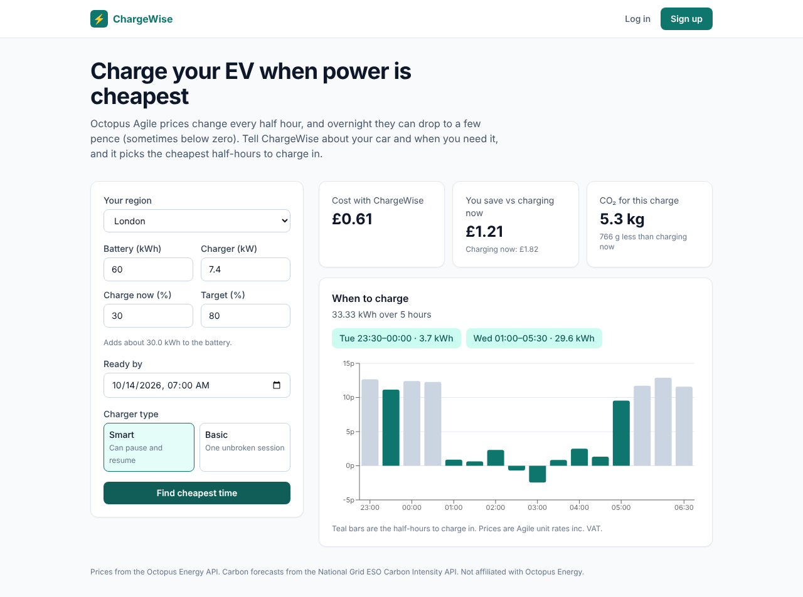
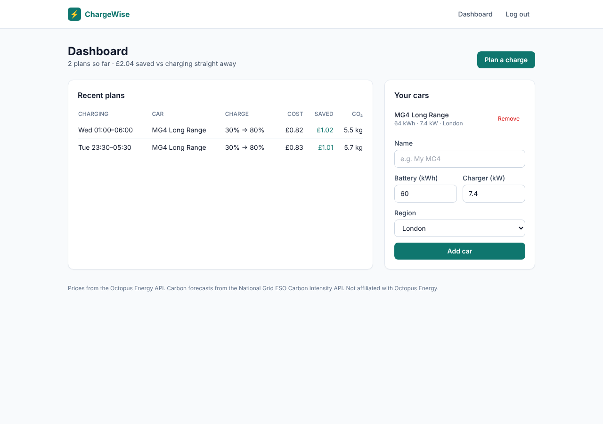
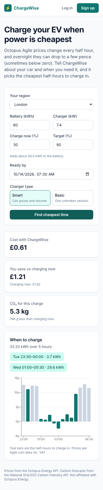

# ChargeWise ⚡

[](https://github.com/Saif1231231/chargewise/actions/workflows/ci.yml)

Find the cheapest and greenest time to charge your electric car at home.

On the Octopus **Agile** tariff, the price of electricity changes every 30 minutes. Overnight it can drop to a few pence per kWh, and sometimes below zero, while the 4–7pm peak can cost several times more. Most people just plug in when they get home. ChargeWise tells you exactly when to charge instead.



## What it does

- **Plans a charge:** enter your region, battery size, current and target charge, charger power and when you need the car. ChargeWise pulls live Agile prices and picks the cheapest half-hours before your deadline.
- **Works with any charger:** *Smart* mode picks the cheapest individual half-hours, for chargers that can pause and resume. *Basic* mode finds the cheapest unbroken block, for chargers that can't.
- **Shows the saving:** compares the cost against plugging in straight away, plus the CO₂ for the charge using the regional carbon intensity forecast.
- **Remembers you:** log in to save your cars and keep a history of plans and total savings.

| Dashboard | Mobile |
|---|---|
|  |  |

## How the planner works

All the logic is in [`src/lib/planner.ts`](src/lib/planner.ts), which is pure TypeScript with no framework code, so it's easy to unit test.

1. **Energy needed** = battery × (target − current) ÷ charging efficiency (90%, since home chargers lose roughly 10% as heat).
2. **Slots needed** = energy ÷ (charger kW × 0.5h), rounded up.
3. Keep only half-hours that **start after now** and **finish before the deadline**.
4. **Smart mode:** sort by price (ties go to lower carbon) and take the N cheapest. **Basic mode:** slide an N-slot window across the timeline and keep the cheapest unbroken block, skipping windows that cross a gap in the data.
5. Every chosen slot runs at full power except the last, which tops up the remainder. The same allocation on the first N slots gives the "charge now" baseline.

Smart mode is a greedy choice, and it's optimal here because each slot's cost is independent of the others. Basic mode is O(n·N), which is fine for at most ~96 slots.

## Tech

| | |
|---|---|
| Frontend | Next.js 15 (App Router), React 19, TypeScript, Tailwind CSS, Recharts |
| Backend | Next.js route handler + server actions |
| Database | PostgreSQL with plain SQL via `pg` ([`db/schema.sql`](db/schema.sql)) |
| Auth | bcrypt password hashes, signed JWT in an httpOnly cookie (`jose`) |
| Validation | zod on every input |
| Testing | Vitest (planner and API clients), GitHub Actions against real Postgres |
| Data | [Octopus Energy API](https://developer.octopus.energy/), [Carbon Intensity API](https://carbonintensity.org.uk/), no keys needed |

### Design decisions

- **Plain SQL instead of an ORM.** The schema is three tables, and writing the queries myself keeps them visible and easy to reason about. Every query that touches user data filters by `user_id` ([`src/lib/queries.ts`](src/lib/queries.ts)).
- **The carbon forecast is optional.** If that API is down you still get a plan, just without CO₂ figures. Prices are required, so if Octopus is down you get a clear error.
- **The Agile product code is looked up, not hard-coded.** Octopus releases new Agile versions (e.g. `AGILE-24-10-01`), so the app asks the API which one is currently on sale.
- **Responses are cached.** Prices are cached for 30 minutes and the product list for a day, so the app doesn't hammer Octopus.

## Run it locally

You need Node 22 and a PostgreSQL database (local, Docker, or a free [Neon](https://neon.tech) project).

```bash
git clone https://github.com/Saif1231231/chargewise.git
cd chargewise
npm install
cp .env.example .env.local      # then set DATABASE_URL and SESSION_SECRET
npm run db:migrate
npm run dev                     # http://localhost:3000
```

```bash
npm test          # unit tests
npm run lint
npm run typecheck
```

## Deploying

`render.yaml` deploys it to Render's free tier. Set `DATABASE_URL` to a Neon connection string. `SESSION_SECRET` is generated for you, and the schema is applied on every start.

## Limitations and next steps

- Agile prices for the next day are published around 4pm, so before then you can only plan up to 11pm tonight.
- Prices are for the standard Agile import tariff; export tariffs aren't considered.
- Next I'd like to add notifications ("plug in now"), a weekly savings chart, and Octopus account linking to read real consumption.

---

Built by [Saif Ali Khan](https://www.linkedin.com/in/saifalikhan-swe). Not affiliated with Octopus Energy.
